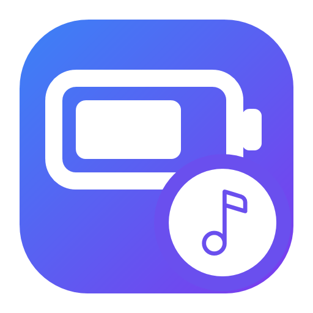
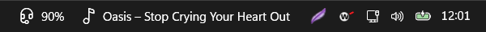

<p align="center">
  
</p>

# Bluetooth Battery Tray

A tiny Windows 10/11 app that shows the **battery level of your connected Bluetooth devices** and the **song currently playing** (Spotify or any other player) right on the taskbar, next to the notification area.



*[Português abaixo](#português)*

## Download

Grab the latest `.zip` from [Releases](../../releases):

| File | When to use |
|---|---|
| `...-self-contained.zip` | Works everywhere, nothing else to install (~70 MB) |
| `...-framework-dependent.zip` | Much smaller, requires the [.NET 10 Desktop Runtime](https://dotnet.microsoft.com/download/dotnet/10.0) |

Extract it and either run `BluetoothBatteryTray.exe` directly (portable), or install it to Program Files with a Start menu shortcut:

```powershell
powershell -ExecutionPolicy Bypass -File install.ps1
```

> **Windows SmartScreen / antivirus warning:** the app is not code-signed yet, so Windows may show
> "Windows protected your PC". Click *More info › Run anyway*. Some antivirus products block unknown
> unsigned executables; add an exception if needed. The full source code is in this repository.

## Features

- Battery level of Bluetooth headphones, headsets, mice, keyboards, gamepads...
  - Classic Bluetooth devices: same value Windows shows in *Settings › Bluetooth & devices*
  - Bluetooth LE devices: also reads the standard GATT Battery Service
- 2.4 GHz wireless receivers (USB dongles), including charging state: currently the **Attack Shark X11**
  (see [Adding a 2.4 GHz receiver](#adding-a-24-ghz-receiver))
- Updates immediately when a device connects/disconnects, and polls the level every 60 s
- Low battery (≤ 20 %) shown in red
- Now playing: uses Windows media controls, so **no Spotify login or API key** is needed.
  Spotify is preferred, any other player works as fallback
- Click the song to play/pause; right-click for next/previous and options
- Follows the light/dark taskbar theme, hides automatically in full-screen games/videos
- Optional start with Windows
- English and Portuguese UI

## Requirements

- Windows 10 (2004+) or Windows 11
- To build: [.NET 10 SDK](https://dotnet.microsoft.com/download)

## Build & run

```powershell
dotnet run --project src/BluetoothBatteryTray
```

## Install from source

Publish a release build, then run the installer (asks for administrator rights):

```powershell
dotnet publish src/BluetoothBatteryTray -c Release -r win-x64 --self-contained -o publish
powershell -ExecutionPolicy Bypass -File scripts\install.ps1
```

This copies the app to `C:\Program Files\BluetoothBatteryTray`, adds a Start menu shortcut and starts it.
Enable *Start with Windows* from the right-click menu.

To uninstall: `powershell -ExecutionPolicy Bypass -File scripts\uninstall.ps1` (add `-RemoveSettings` to also delete settings).

## Settings

Right-click the overlay › *Open settings...* (`%AppData%\BluetoothBatteryTray\settings.json`). Changes are applied as soon as the file is saved.

| Setting | Default | Description |
|---|---|---|
| `RefreshIntervalSeconds` | `60` | How often battery levels are polled |
| `LowBatteryThreshold` | `20` | At or below this %, the value turns red |
| `ShowDevicesWithoutBattery` | `false` | Also show connected devices that don't report battery |
| `HiddenDevices` | `[]` | Device names to hide, e.g. `["My Speaker"]` |
| `ShowMedia` | `true` | Show the song currently playing |
| `PreferredMediaApp` | `"Spotify"` | Player to prefer (empty = whatever Windows considers current) |
| `OnlyPreferredMediaApp` | `false` | Ignore every player except the preferred one |
| `HideMediaWhenPaused` | `false` | Hide the song when paused |
| `MaxMediaChars` | `40` | Max length of the song label |
| `RightOffsetPx` | `null` | Manual position: pixels from the right edge of the taskbar |
| `MarginPx` | `4` | Gap between the overlay and the notification area |

Logs: `%AppData%\BluetoothBatteryTray\log.txt`.

## Limitations

- Devices connected through a proprietary USB dongle use a different protocol per brand/model, so each one has to be added individually (only the Attack Shark X11 so far).
- Some devices simply don't report battery level to Windows.
- Windows 11 no longer allows real taskbar extensions, so this is an always-on-top window positioned over the taskbar (same technique used by other taskbar monitors). Only horizontal taskbars on the primary monitor are supported.

## How it works

| What | API |
|---|---|
| Connected devices | `Windows.Devices.Enumeration` (association endpoints, `System.Devices.Aep.IsConnected`) |
| Battery (classic) | PnP property `DEVPKEY_Bluetooth_Battery` `{104EA319-6EE2-4701-BD47-8DDBF425BBE5} 2` |
| Battery (LE) | GATT Battery Service `0x180F` / Battery Level `0x2A19` |
| Now playing | `GlobalSystemMediaTransportControlsSessionManager` |
| Position | `Shell_TrayWnd` / `TrayNotifyWnd` window rectangles |

## Adding a 2.4 GHz receiver

Mice and keyboards with their own USB receiver don't report battery to Windows; only the vendor software knows how to ask.
Many receivers, however, broadcast a status report on their own, which this app can listen to (it never sends commands).

1. Find the receiver's vendor/product id (Device Manager › the device › Details › Hardware Ids, e.g. `VID_1D57&PID_FA60`).
2. Run the read-only probe while moving the mouse and, if available, with the vendor software open on its battery screen:
   ```powershell
   powershell -ExecutionPolicy Bypass -File tools\hid-probe.ps1 -Filter "vid_1d57&pid_fa60" -ListenSeconds 40
   ```
3. Look for a report that repeats periodically and contains the battery percentage (e.g. `0x64` = 100), then compare with
   the vendor software at a different charge level.
4. Add the model to `Models` in [ReceiverBatteryService.cs](src/BluetoothBatteryTray/Services/ReceiverBatteryService.cs) and open a pull request,
   or open an issue with the probe output (`hid-probe-result.txt`).

## Releasing

Push a tag and GitHub Actions builds both zips and publishes the release:

```powershell
git tag v0.1.0
git push origin v0.1.0
```

The app icon is generated by [tools/make-icon.cs](tools/make-icon.cs): `dotnet run tools/make-icon.cs -- src/BluetoothBatteryTray/Assets`.

## License

[MIT](LICENSE)

---

## Português

Aplicativo para Windows 10/11 que mostra na barra de tarefas a **% de bateria dos dispositivos Bluetooth conectados** (fones, mouses, teclados...) e a **música tocando** no Spotify ou em qualquer outro player.

- Baixe o `.zip` em [Releases](../../releases), extraia e rode o `BluetoothBatteryTray.exe` (ou `install.ps1` para instalar)
- O Windows pode avisar "O Windows protegeu o computador" porque o app ainda não é assinado: *Mais informações › Executar assim mesmo*
- Para rodar a partir do código: `dotnet run --project src/BluetoothBatteryTray`
- Clique na música para tocar/pausar; botão direito para próxima/anterior e opções
- Configurações: botão direito › *Abrir configurações...* (aplicadas ao salvar o arquivo)
- Não precisa de login nem chave da API do Spotify: usa os controles de mídia do próprio Windows
